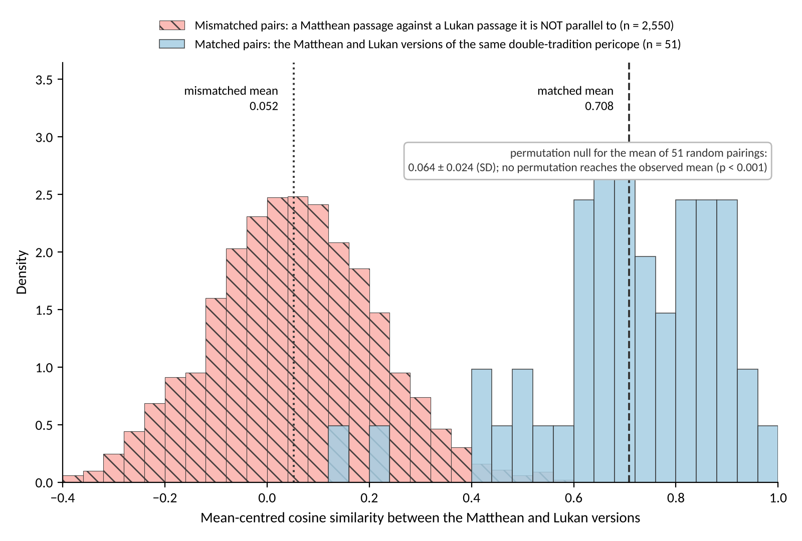

# STCM — Synoptic Transform Calibration Model

> A calibrated source-analysis approach to the Synoptic Problem
> using embedding-space geometry.

[](https://doi.org/10.5281/zenodo.21761951)

📖 **[Documentation & Interactive Results](https://agnieszkachr.github.io/stcm/)**

> [!IMPORTANT]
> **MODEL NOTICE**: This repository uses **`ABeZet/Koine-Greek-BERT`** as the embedding model (replacing the classical Ancient Greek BERT baseline used in early experiments). The register-specific model resolves vocabulary-register issues in the synoptic gospels — notably, the *Beatitudes* (Matt 5:3–12 / Luke 6:20–23) now sit well above the triple-tradition calibration mean (centred cosine 0.7075 against 0.5681). All calibration signatures, permutation tests, and downstream outputs were regenerated with the new model.
>
> **VERSION 2 (October 2026) — corrected alignment and encoding.** An audit of the pipeline found (i) false, duplicated and leaking pairs in the pericope tables (a Matthean text aligned to the wrong Markan episode, a non-parallel Matthew–Luke "pair", one pericope entered twice, the Temptation in both calibration and test set, Mark–Q overlaps in the calibration set, `Leaven of the Pharisees` pairing Markan material with Q), (ii) silent truncation of texts longer than 512 subword tokens, and (iii) critical-apparatus sigla reaching the model as unknown tokens. All three are fixed: the tables follow explicit rules (no verse in two units, no verse in both sets, units trimmed to parallel verses, non-contiguous ranges supported) and now cover the IQP inventory (51 double-tradition, 46 triple-tradition pericopes); long texts are chunked at sentence boundaries and averaged, never truncated; sigla are stripped. The directionality analysis was rebuilt with an intercept, data-chosen ridge penalty, jackknife CI and two controls (a length-balanced subset and the known Mark → Matthew/Luke direction), and length-matched permutation nulls were added. Every number below is from the regenerated run; earlier numbers (36/49 pericopes) are superseded.

## Overview

STCM is a computational research tool that investigates the **Synoptic Problem** — the literary relationship among the three synoptic gospels (Matthew, Mark, Luke) — through NLP embedding analysis.

The core hypothesis under test: **do the double-tradition pericopes (passages found in Matthew and Luke but absent from Mark) exhibit an embedding-space signature consistent with derivation from a shared written source (the hypothetical Q document)?**

### Method

1. **Alignment** — Pericopes are delimited by the Aland synopsis and the IQP inventory under three enforced rules: each pair is trimmed to the verses actually parallel (non-contiguous ranges are supported, e.g. Luke 3:7–9 + 16–17), no verse belongs to two units of the same set, and no verse belongs to both the calibration and the test set. Mark–Q overlaps are excluded from calibration.

2. **Embedding** — Each pericope is encoded as one sequence with [Koine-Greek-BERT](https://huggingface.co/ABeZet/Koine-Greek-BERT) (mean-pooled last hidden state, unit-normalised). Texts longer than the 512-token window are split at sentence boundaries and the chunk vectors averaged with token weights; nothing is truncated. SBLGNT apparatus sigla are stripped before encoding.

3. **Calibration** — Triple-tradition pericopes (Matt + Mark + Luke, *n* = 46) give the cosine distribution for known source-sharing (Signature A) and the residual correlation against each pericope's own Markan text (Signature B).

4. **Primary statistic** — The **mean-centred cosine** (anisotropy-corrected, weight-free) carries all inference and ranking; the raw cosine and the residual correlation against the Mark centroid are analysed in parallel. The legacy composite index runs only with `--legacy`.

5. **Nulls and controls** — Random, thematic, length-matched and length-and-theme-matched permutation nulls; genre floor for the residual signature; sentence-level bootstrap; word-overlap baseline; length, form, stratum and Goulder-set covariates; directionality via leave-one-out ridge with intercept, data-chosen penalty, jackknife CI, sign-flip test, and two controls (length-balanced subset; known Mark → Matthew/Luke direction).

6. **Cross-tradition comparison** — Each tradition is measured against **its own** mismatched-pair floor and against a nearest-non-parallel floor (size-matched by subsampling the larger set to the smaller over 1,000 draws), under six centring schemes.

### Key Results

| Metric | Value |
|--------|-------|
| Embedding model | `ABeZet/Koine-Greek-BERT` (DAPT of Ancient-Greek-BERT; corpus incl. LXX, NT, Apostolic Fathers, Hellenistic historians) |
| Corpus | 51 double-tradition pairs, 46 triple-tradition triples (240 pericope vectors) |
| Triple-tradition calibration (Sig-A) | μ = 0.9571, σ = 0.0231 (95% CI: [0.9500, 0.9637]); centred mean 0.5681 |
| Residual signature (Sig-B) | μ = 0.3542, σ = 0.1359 |
| **Centred cosine (primary statistic)** | matched mean 0.7171 (SD 0.1737) vs unrelated-pair floor 0.0517; random null 0.0635 (SD 0.0239), *z* = 27.3; thematic null 0.1098, *z* = 31.6; length-matched null 0.0924, *z* = 28.3; length+theme null 0.1387, *z* = 29.2; all *p* < 0.001 |
| **Excess over own mean floor (DT vs TT)** | raw 0.1131 vs 0.0506; centred 0.6654 vs 0.5165 — the double tradition exceeds the Markan calibration set in **both** geometries |
| **Excess over nearest non-parallel pair** | raw 0.0467 vs 0.0116; centred 0.3325 vs 0.1803 (double tradition subsampled to n = 46, 1,000 draws: raw 0.0473 [0.0439, 0.0506], centred 0.3371 [0.3168, 0.3589]; none reaches the triple-tradition value) |
| Centring sensitivity | ordering invariant across all six centring schemes (240 / 102 / 138 / Mark-only / balanced / Matt+Luke-only) |
| Internal homogeneity (raw) | triple tradition Matt 0.9093, Luke 0.9074; double tradition Matt 0.8341, Luke 0.8420 |
| Raw-cosine permutation tests (concordant) | observed 0.9509 vs random null 0.8398 (SD 0.0041), *z* = 27.1; thematic null 0.8470, *z* = 19.9; length-matched 0.8466, *z* = 22.8; length+theme 0.8542, *z* = 27.0; all *p* < 0.001 |
| Residual genre floor | matched 0.7558 vs mismatched floor 0.1982; *z* = 27.5 / 29.3; *p* < 0.001 |
| Sentence-level bootstrap SD (centred) | 0.1227 (range of statistic: [0.1464, 0.9788]) |
| Length / form / stratum | length (chars) *r* = 0.060, *p* = 0.675; form Kruskal–Wallis *p* = 0.029 (discourse 0.805 > narrative 0.750 > proverbial 0.688 > parable 0.573 — a covariate, not a short-saying artefact); strata Q¹ 0.717 vs Q² 0.722, *p* = 0.956 |
| Word-overlap Pearson r (centred) | 0.797 (~37% variance unexplained) |
| Goulder redaction test (centred) | 0.614 (n = 10) vs 0.742 (n = 41); Welch's *t* = −1.498, *p* = 0.164, *d* = −0.767 (inconclusive, underpowered) |
| Directionality | Δ*R*² = +0.024 (L\|M 0.233 vs M\|L 0.209, α = 1 by LOO); jackknife CI [−0.003, +0.050]; sign-flip *p* = 0.004 — but regulariser-dependent (→ 0 at α ≥ 10), absent in length-balanced pairs (Δ*R*² = +0.010, *p* = 0.58), and the statistic **fails the positive control** (Mark → Matthew *p* = 0.73, Mark → Luke *p* = 0.68): **no directional inference drawn** |
| Reconstruction convergence | 100% |

**Top 5 pericopes by centred cosine:**

1. Serving Two Masters (0.9788)
2. Harvest Plentiful (0.9549)
3. Lament over Jerusalem (0.9441)
4. Hidden from Wise, Revealed (0.9153)
5. Return of Unclean Spirit (0.9086)



## Quickstart

```bash
# 1. Clone and enter the repo
cd stcm

# 2. Create venv and install dependencies (uv)
uv venv
uv pip install -r requirements.txt
# (or with pip: pip install -r requirements.txt)

# 3. Download SBLGNT source texts
python download_sblgnt.py

# 4. Run the full pipeline (load, embed, calibrate, advanced analysis, figures)
python run_pipeline.py

# 5. Resume after an interruption
python run_pipeline.py --resume

# 6. Also run the retired composite-index / reconstruction / evaluation_summary steps
python run_pipeline.py --legacy

# 7. Advanced analysis alone (all article statistics; runs from the embedding
#    cache — the model is needed only for the sentence-level bootstrap on a cold cache)
python advanced_analysis.py

# 8. Regenerate the article figures from the centred ranking and key_stats.json
python generate_evaluation_figures.py
```

### Output files

```
outputs/
├── figures/
│   ├── q_score_histogram.png          # Legacy pipeline visualisation (--legacy)
│   └── evaluation/fig1–fig6 …         # Article figure set (centred metric)
├── models/
│   ├── calibration_signatures.pkl     # Calibrated signatures
│   └── reconstructed_q_embeddings.pkl # (--legacy)
└── reports/
    ├── advanced_analysis.md           # ALL article statistics (Tables 1, 2, 4; nulls; directionality)
    ├── centred_cosine_ranking.csv     # Primary per-pericope ranking (all 51, with refs, form, stratum, length, overlap)
    ├── calibration_table.csv          # Table 1
    ├── key_stats.json                 # Figures read the null parameters from here
    ├── evaluation_summary.md          # LEGACY suite on the retired composite index (--legacy)
    ├── q_score_distribution.csv       # LEGACY per-pericope composite index (--legacy)
    └── system_validation.txt          # LEGACY system report (--legacy)
```

## Architecture

```
stcm/
├── stcm/
│   ├── __init__.py        # Package metadata
│   ├── config.py          # Configuration with env-var overrides
│   ├── utils.py           # Greek normalisation, SBLGNT parsing, math helpers
│   ├── data_loader.py     # SBLGNT loader + alignment tables (multi-range refs, integrity checks)
│   ├── metadata.py        # Thematic tags, form classes, Kloppenborg strata, Goulder set (single source)
│   ├── embeddings.py      # Koine-Greek-BERT pipeline: chunked encoding, versioned cache
│   ├── calibration.py     # Triple-tradition signature computation
│   ├── scoring.py         # Legacy composite index (--legacy)
│   ├── reconstruction.py  # Legacy latent-Q estimation (--legacy)
│   └── evaluation.py      # Legacy evaluation suite + BERT validation (--legacy)
├── advanced_analysis.py            # Anisotropy, floors, centring sensitivity, directionality, ranking
├── generate_evaluation_figures.py  # Article figures from the centred ranking
├── site/                  # Markdown source files for MkDocs (docs_dir)
├── docs/                  # Generated HTML site for GitHub Pages (site_dir)
├── run_pipeline.py        # End-to-end pipeline runner (resumable)
├── download_sblgnt.py     # SBLGNT data downloader
└── mkdocs.yml             # MkDocs configuration
```

## Configuration

All settings can be overridden via environment variables with the `STCM_` prefix:

```bash
# Use a different embedding model
STCM_EMBEDDING_MODEL=bert-base-multilingual-cased python run_pipeline.py

# Change log level
STCM_LOG_LEVEL=DEBUG python run_pipeline.py
```

Embedding vectors are cached on disk under a key that includes the model identifier, the encoding-scheme version (`v2`: sigla stripped, chunked, never truncated) **and** the normalised text, so neither switching models nor changing the encoding can silently reuse stale vectors. Cache writes are atomic, and the model itself is loaded lazily — a fully cached corpus can be analysed without the model weights (or torch/transformers) installed.

If the transformer model cannot be loaded on a cache miss, the pipeline stops with an error. A deterministic offline n-gram embedder can be enabled for smoke-testing only with `STCM_ALLOW_FALLBACK=1`; its results are **not** comparable to the published outputs, and the embedder actually used is recorded in `system_validation.txt`.

## Methodology

### Signature A — Independent Tradition Baseline

For each triple-tradition pericope (n = 46), we compute `cos(emb(Matt), emb(Luke))`. This yields a distribution of expected Matt–Luke similarities when both evangelists share a common Markan source. The calibrated mean (0.9571) and 95% CI [0.9500, 0.9637] define the expected similarity range; the mean-centred equivalent is 0.5681 (95% CI [0.5207, 0.6148]).

### Signature B — Residual Dependence

The residual of Matthew relative to Mark captures what Matthew *adds* beyond the Markan template. If Matthew and Luke independently used Q in addition to Mark, their residuals should correlate. The calibrated mean residual cosine similarity is 0.3542.

For double-tradition pericopes (where Mark is absent), the residual is computed relative to the **Mark centroid** — the mean embedding of all Mark's triple-tradition pericopes. Because Mark's material is overwhelmingly narrative whilst the double tradition is predominantly discourse, any two discourse passages show correlated displacement against this narrative baseline. This genre-level elevation is **quantified directly** as the mean residual correlation among mismatched pairs (the genre floor, 0.1982); the evidential quantity is the matched-pair excess over that floor (0.7558 − 0.1982 = 0.5576, *p* < 0.001). Note that the residual *norm* (how far a text lies from the centroid) is a near-deterministic function of passage length (Spearman ρ = −0.82) and is not used as evidence of anything.

### Primary Statistic — Mean-Centred Cosine

Contextual embedding spaces are anisotropic: vectors crowd into a narrow cone, so even unrelated texts show high raw cosine similarity (Ethayarajh 2019). The primary statistic therefore subtracts the corpus mean vector (computed over all 240 pericope embeddings) before computing cosines (cf. Su et al. 2021). Under this correction, unrelated pairs average ≈ 0.05 while correctly paired double-tradition passages average 0.72. The centred cosine carries **all inference and ranking**; it has no tunable parameters. The per-pericope ranking is released as `outputs/reports/centred_cosine_ranking.csv`.

### Comparing the Two Traditions

The corpus mean used for centring is not neutral between the traditions: 138 of the 240 vectors are triple-tradition, so the origin lies nearer that material and centring shortens those vectors more (mean centred norm 0.3078 for triple-tradition Matt/Luke vectors against 0.4045 for double-tradition ones). Comparing the two matched means directly would therefore flatter the double tradition. Each set is instead measured against **its own** mismatched-pair floor.

On that basis the result does not depend on the anisotropy correction at all. In the raw space the matched means are nearly identical (0.9509 and 0.9571), but the triple-tradition floor is far higher (0.9064 against 0.8378) because that material is internally homogeneous narrative inherited from Mark. The excess over floor is 0.1131 against 0.0506.

Two further controls close the remaining gaps. A **nearest-neighbour floor** — each pericope against the most similar passage it is *not* parallel to — removes any advantage the double tradition might gain from being internally more varied; because that statistic is an order statistic and rises with pool size, the larger set (now the double tradition, 51) is subsampled to the smaller (46) over 1,000 draws. A **centring-sensitivity analysis** repeats everything under six definitions of the centring vector. The ordering survives every one of these.

A legacy composite index (0.8 × cosine + 0.2 × max(0, residual)) and the latent-Q reconstruction survive only behind `run_pipeline.py --legacy`; they play no part in the article.

## Evaluation Suite

`advanced_analysis.py` computes every statistic in the article and writes `outputs/reports/advanced_analysis.md`:

1. **Permutation tests** on the centred cosine (primary), the raw cosine and the residual correlation, each against four nulls — random pairing, thematic pairing, length-matched pairing (|log length ratio| ≤ 0.4) and length-and-theme-matched pairing (1,000 draws each). Length matching is needed because true parallels are of similar length and the similarity of unrelated passages falls as their lengths diverge (ρ = −0.20 over the 2,550 mismatched pairs).
2. **Cross-tradition floor comparison** — mismatched-pair floor for both traditions, so each set is read against its own baseline.
3. **Nearest-neighbour floor with size matching** — the most similar non-parallel pair, controlling for internal homogeneity; the larger set is subsampled to the smaller over 1,000 draws.
4. **Centring-vector sensitivity** — six centring schemes; the ordering is invariant.
5. **Genre floor** for the residual signature.
6. **Directionality** — leave-one-out ridge with intercept (hat-matrix identity), penalty chosen by LOO error and reported across a grid, jackknife SE, sign-flip permutation test, plus a length-balanced subset and the known-direction control (Mark → Matthew / Luke in the triple tradition). The statistic does not recover the known direction, so no directional inference is drawn.
7. **Covariates** — length (characters), form-critical class, Kloppenborg stratum, Goulder set, word-level Jaccard overlap.
8. **Sentence-level bootstrap** — 200 resamples per pericope on the centred cosine.

`generate_evaluation_figures.py` draws Figures 1–6 from `centred_cosine_ranking.csv` and `key_stats.json`. The legacy evaluation suite (`stcm/evaluation.py`: composite-index permutation tests, weight sensitivity, Goulder test and bootstrap on the composite, internal BERT validation) runs only with `--legacy`; its BERT validation (four triple-tradition parallels vs two unrelated pairs: raw 0.964 vs 0.850, centred 0.48–0.76 vs 0.02–0.04) is the one legacy number cited in the article.

### Pre-training disclosure

The embedding model's domain-adaptation corpus includes the New Testament itself (alongside the Septuagint, Apostolic Fathers, and Hellenistic historians). Masked-language-model pre-training involves no pairing supervision — the model is never told which Matthean passage parallels which Lukan one — and all statistical inference in STCM is contrastive within the corpus (matched vs. permuted pairings of the same in-domain texts), with the primary statistic computed in the mean-centred space. Absolute similarity values nevertheless inherit an in-domain elevation and should not be compared across models.

## Falsifiability

This model is explicitly falsifiable on six criteria:

1. **If the random permutation test p-value is ≥ 0.05** → signal indistinguishable from random pairing.
2. **If the thematic-null permutation test p-value is ≥ 0.05** → signal attributable to topical similarity alone.
3. **If the matched-pair contrast vanished under anisotropy correction** → the signal would be an artefact of representation geometry (instead it widens, 0.113 → 0.665).
4. **If the matched residual correlation did not exceed the mismatched-pair genre floor** → Signature B would reflect genre displacement alone (instead: 0.7558 vs 0.1982).
5. **If the length-matched null p-value is ≥ 0.05** → signal attributable to the matched lengths of true parallels.
6. **If the word-overlap correlation approaches 1.0** → embeddings add nothing beyond traditional concordance work (*r* = 0.797).

## Limitations

- The model tests *consistency* with the Q hypothesis, not *truth*. High centred similarity does not prove Q exists — it shows the embedding geometry is what we'd expect if Q existed. In particular, mutual similarity does not discriminate between independent use of Q and Luke's direct use of Matthew; the predictability-asymmetry statistic does not detect even the known direction of Markan copying, so no directional inference is drawn.
- Literary form is associated with the statistic (parables lowest, discourses highest); whether this reflects transmission or representation cannot be settled within the corpus.
- The model's tokeniser lower-cases and strips diacritics at inference, so the polytonic vocabulary entries are not reached; the comparison is insensitive to accentuation.
- The Mark centroid used for double-tradition residuals is a global average, not a pericope-specific proxy, and the genre floor that bounds the resulting confound is estimated within the synoptic corpus itself (an internal rather than external control).
- Results depend on the embedding model's capture of Koine Greek semantics, and the pre-training corpus includes the New Testament (see Pre-training disclosure above).
- All floors — mean, genre and nearest-neighbour alike — are estimated inside the synoptic corpus itself. They are internal controls; an external corpus of contemporaneous Koine narrative and discourse would be needed for an independent estimate.
- Pericope delimitation is a scholarly decision the method cannot audit: a truncated unit can move a pericope across most of the ranking (see *John's Preaching* in the article). The tables follow explicit rules, but other defensible delimitations exist.
- The sample size (51 double-tradition, 46 triple-tradition pericopes) constrains statistical power for sub-group analyses.

## Data Source

Greek text: [SBLGNT](https://github.com/LogosBible/SBLGNT) (SBL Greek New Testament), released under the [SBLGNT EULA](https://www.sblgnt.com/license/). Used for research purposes.

## Citation

Archived on Zenodo. Cite the concept DOI [10.5281/zenodo.21761951](https://doi.org/10.5281/zenodo.21761951), which always resolves to the latest release; the DOI of any individual version is listed on that record under *Versions*.

```bibtex
@software{stcm2026,
  author    = {Ziemińska, Agnieszka},
  title     = {STCM: Synoptic Transform Calibration Model},
  year      = {2026},
  publisher = {Zenodo},
  doi       = {10.5281/zenodo.21761951},
  url       = {https://github.com/Agnieszkachr/stcm},
  note      = {A calibrated source-analysis approach to the Synoptic Problem}
}
```

## License

MIT — see [LICENSE](LICENSE).

## Reproducibility

All pipeline outputs are fully deterministic given:
- SBLGNT text files (downloaded via `download_sblgnt.py`)
- Koine-Greek-BERT model weights (from HuggingFace)
- Python 3.11+ with dependencies per `requirements.txt`
- Random seed 42 (default, configurable)
