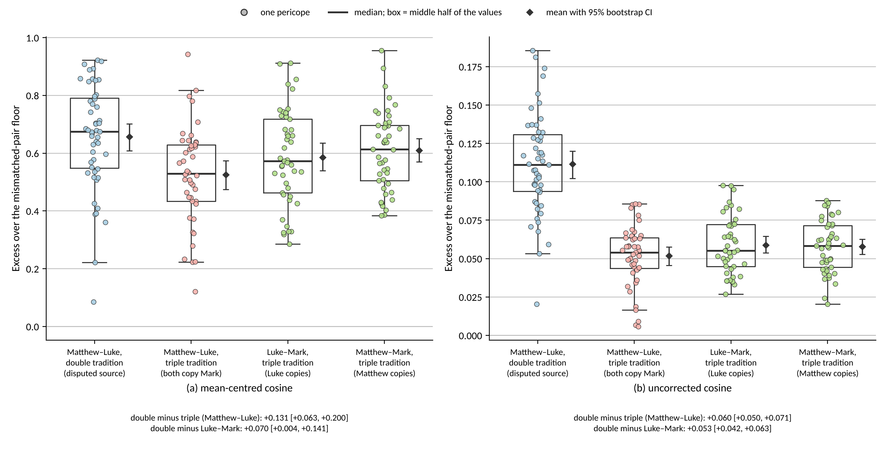
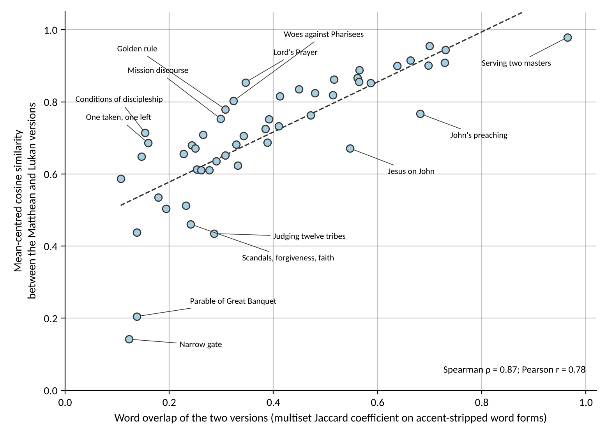
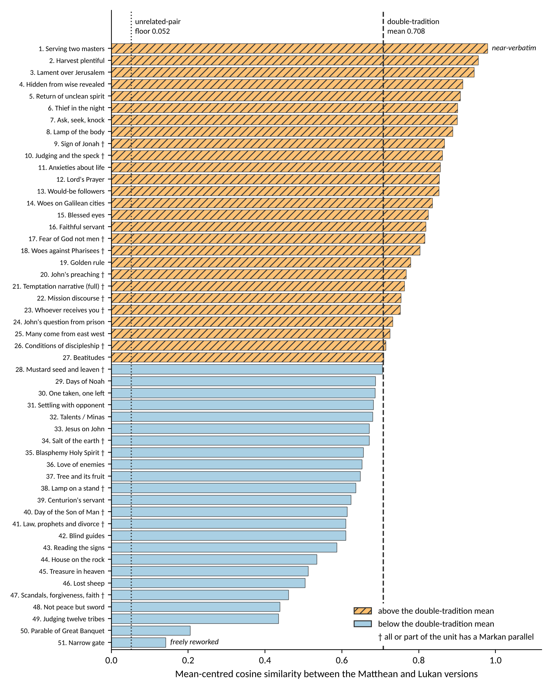
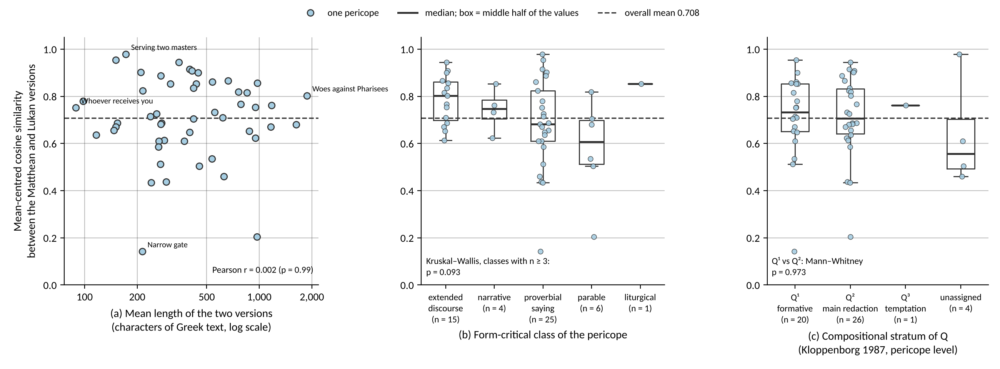

# Results

All figures on this page are from the **version-3 run** (October 2026): 51 double-tradition and 45 triple-tradition pericopes, range-wise encoding of composite units, the model pinned to Koine-Greek-BERT v1.0.1. Earlier figures (version 2: 46 triple-tradition pericopes, matched mean 0.7171; version 1: 36/49 pericopes) are superseded. Every number is in `outputs/reports/` and `key_stats*.json`.

## 1. Positive and negative controls

In the triple tradition, where Matthew and Luke both copy Mark, the mean-centred cosine is **0.578** between Matthew and Luke (two independent copies of one source) and **0.679 / 0.651** between Matthew and Mark / Luke and Mark (a copy and its source). Two independent copies agree less with each other than each does with its source, as they should. Mismatched pairs fall to **≈ 0.05** in every set after centring (raw cosine of unrelated passages ≈ 0.84–0.91). The representation passes both controls.

The 51 double-tradition matched pairs average **0.708** (SD 0.175, range 0.142–0.979) against a mismatched floor of 0.052, and exceed four permutation nulls — random 0.064, thematic 0.110, length-matched 0.086, length-and-theme-matched 0.132 — with *p* < 0.001 in every case. The uncorrected cosine is concordant (0.950 against nulls of 0.841–0.854).

## 2. Comparing the traditions — excess over each set's own floor

| Set | Excess over mean floor, centred [95% CI] | raw [95% CI] |
|---|---|---|
| Double tradition, Matt–Luke | 0.656 [0.609, 0.702] | 0.112 [0.102, 0.120] |
| Triple tradition, Matt–Luke (two-step copying) | 0.525 [0.475, 0.574] | 0.052 [0.046, 0.058] |
| Triple tradition, Luke–Mark (one-step copying) | 0.586 [0.540, 0.635] | 0.059 [0.054, 0.065] |
| Triple tradition, Matt–Mark (one-step copying) | 0.609 [0.570, 0.650] | 0.058 [0.053, 0.063] |

- **Double minus two-step copying:** +0.131 [0.063, 0.200] centred, +0.060 [0.050, 0.071] raw — robust: it holds against the nearest-neighbour floor, with the double tradition size-matched, without the 16 Mark–Q overlap units (+0.142), under all six centring vectors, with the last-four-layer encoding and with Ancient-Greek-BERT, which has not seen the New Testament.
- **Double minus one-step copying (Luke–Mark):** +0.053 [0.042, 0.063] raw, but only +0.070 [0.004, 0.141] centred, and not stable across centring vectors or encoders. The safe statement: Matthew and Luke agree in the double tradition *at least as closely* as Luke agrees with Mark where he copies him.
- **Kind of material:** the double tradition is mostly sayings, the triple tradition mostly narrative. Against the 11 sayings-dominant triple-tradition units the centred advantage shrinks to +0.077 [−0.061, 0.230], and against Luke–Mark copying of the same units it vanishes (−0.036). In the uncorrected space it persists (+0.060, +0.041). Part of the two-step contrast is a sayings-versus-narrative effect.

## 3. What the embedding adds to word overlap

Plain word overlap (multiset Jaccard) and character n-gram TF-IDF reproduce the same ordering (Jaccard excess: double 0.313, two-step 0.167, Luke–Mark 0.214) and most of the ranking (Spearman ρ = 0.87 with the centred cosine). The headline contrast is **not** specific to the transformer.

What is specific: after regressing the centred cosine on Jaccard over all 2,601 Matthew–Luke pairs, the residual still separates matched pairs (+0.180) from mismatched ones (−0.004), *p* < 0.001 against all nulls, and the double tradition's advantage survives on the residual (+0.085 [0.021, 0.147]). The pericopes the embedding rates higher than their word overlap predicts are cases of paraphrase — *Conditions of Discipleship* ("loves … more than me / is not worthy of me" against "does not hate … / cannot be my disciple"), *One Taken, One Left*, the *Golden Rule*, the *Lord's Prayer*.

## 4. Ranking and covariates

**Top 5:** *Serving Two Masters* (0.979), *Harvest Plentiful* (0.955), *Lament over Jerusalem* (0.944), *Hidden from Wise, Revealed* (0.915), *Return of Unclean Spirit* (0.908). **Bottom:** *Narrow Gate* (0.142), *Great Banquet* (0.205).

- Length: Pearson *r* = 0.002 (*p* = 0.99).
- Form: discourse 0.785 > narrative 0.743 > proverbial 0.683 > parable 0.575, but Kruskal–Wallis *p* = 0.093 and no pairwise difference survives correction — a pattern, not a finding.
- Kloppenborg strata: Q¹ 0.714 vs Q² 0.713 (*p* = 0.97).
- Goulder set: 0.607 vs 0.733 (*p* = 0.17, *d* = −0.75) — underpowered, inconclusive.
- Sentence-level bootstrap: median per-pericope SD 0.117 (mean 0.133, 47 pericopes with ≥ 2 sentences in each version).

## 5. Shared deviation from Mark (minor agreements)

In the triple tradition, the component of Matthew's vector orthogonal to Mark's correlates with Luke's at **0.364**, against **0.058** for mismatched pericopes (random null 0.065, length-matched null 0.063, *p* < 0.001). Where Matthew and Luke both depart from Mark, they tend to depart in the same direction in the same pericope — the geometric trace of the minor agreements. The geometry cannot say whether this reflects Luke's knowledge of Matthew or coincident redaction.

## 6. Directionality

Δ*R*² = +0.024 (Luke from Matthew 0.219 vs Matthew from Luke 0.195; sign-flip *p* = 0.005) — but penalty-dependent (from +0.057 to 0), absent among the 30 length-balanced pairs (*p* = 0.38), and the statistic **fails the positive control** (Mark → Matthew *p* = 0.62; Mark → Luke *p* = 0.84). No directional inference is drawn.

## Conclusion

The representation can be validated on known dependence, and once validated it measures the double tradition as closer than two-step Markan copying and at least as close as one-step copying, with part of the first contrast due to the kind of material. Most of this is visible in word overlap; the embedding's own contribution is a residual sensitivity to agreement across a change of wording. It does not tell who copied whom.
