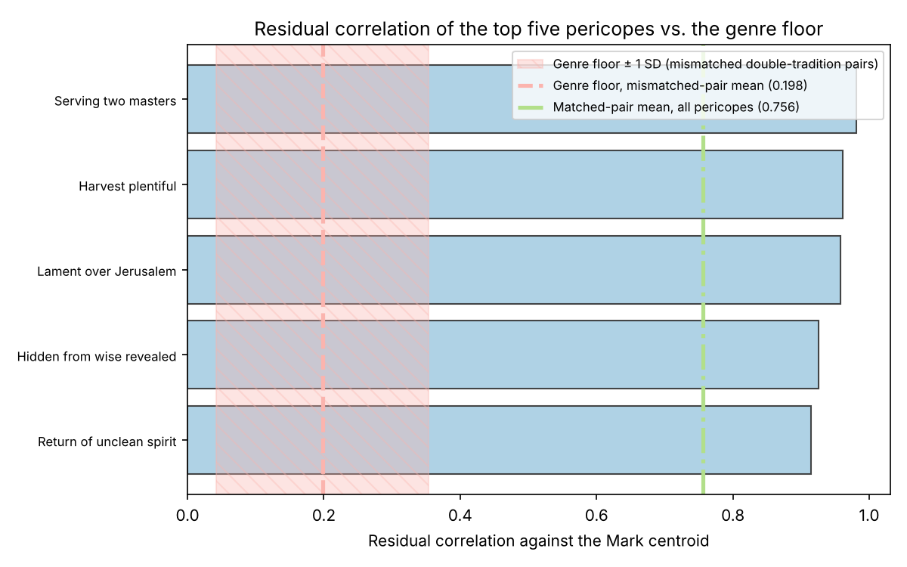
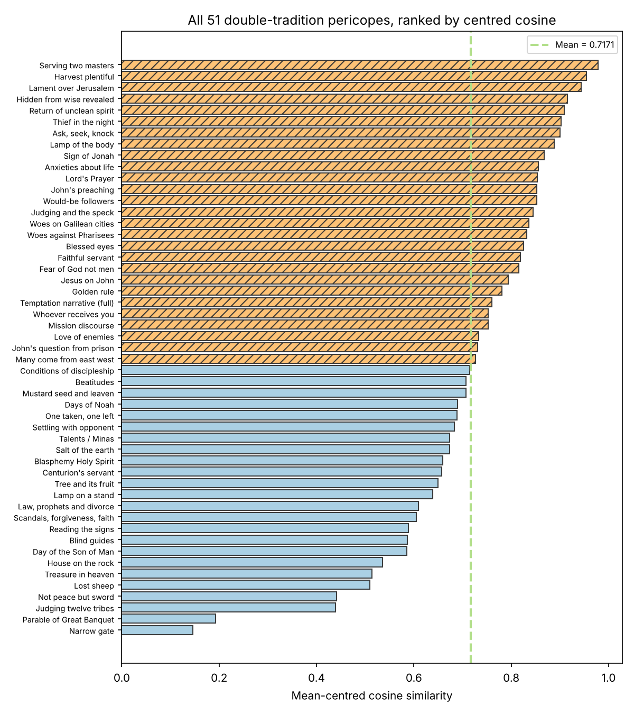
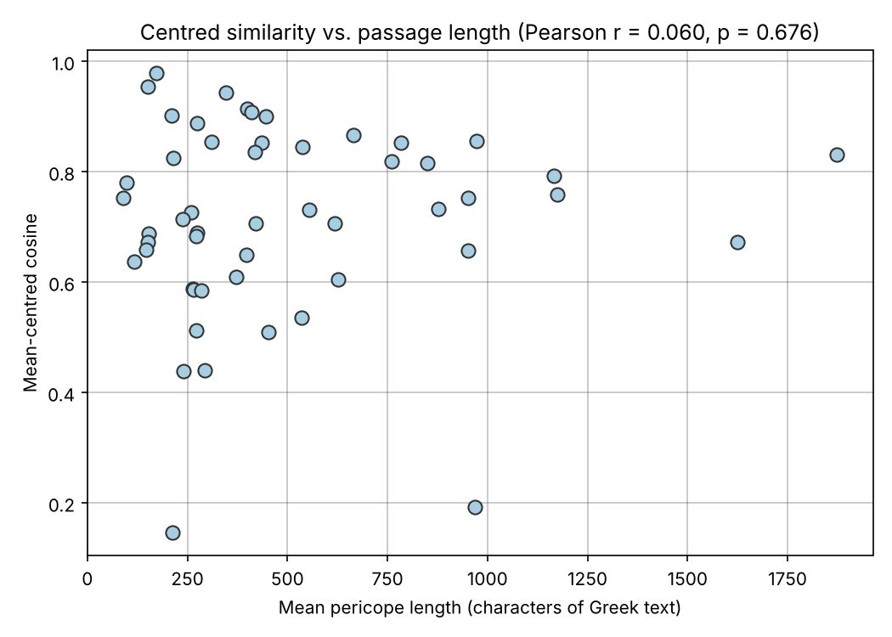
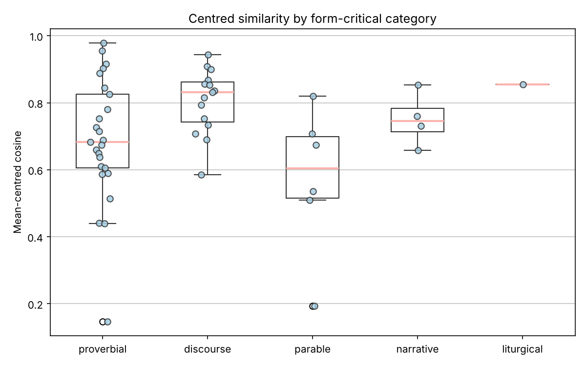
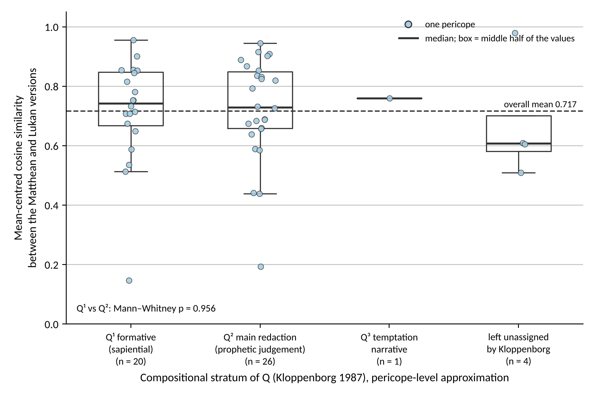

# Results

The outputs from STCM provide a calibrated, quantitative measurement of the literary relationship among the double-tradition texts: their geometry is consistent with derivation from a common written source, whilst not by itself adjudicating between the Two-Source and Farrer hypotheses. All figures on this page are from the version-2 run (October 2026: corrected alignment tables, chunked encoding, sigla stripped; 51 double-tradition and 46 triple-tradition pericopes). Earlier figures based on 36/49 pericopes are superseded.

## 1. Triple Tradition Baseline (Signature A)
When analysing the 46 Triple Tradition pericopes where Matthew, Mark, and Luke all overlap with a plain Markan parallel, the mean cosine similarity between Matthew and Luke is **0.9571** (σ = 0.0231, 95% CI [0.9500, 0.9637]); after mean-centring the corpus (anisotropy correction) the baseline is 0.5681 (95% CI [0.5207, 0.6148]). Because we know under Markan priority that both authors drew from Mark, this gives us a quantitative measure of what a "shared source derivation" looks like in the `Koine-Greek-BERT` space. The residual correlation against each pericope's own Markan text (Signature B) averages 0.3542 (σ = 0.1359).

## 2. Double Tradition Scoring
The primary statistic for both inference and ranking is the **mean-centred cosine similarity** (anisotropy-corrected; no tunable parameters). Across the 51 Double Tradition pericopes the matched-pair mean is **0.7171** (SD 0.1737, range [0.1464, 0.9788]) against an unrelated-pair floor of **0.0517**; the mean raw Matt–Luke cosine is 0.9509.

**Top 5 pericopes by centred cosine:**

1. *Serving Two Masters* (0.9788)
2. *Harvest Plentiful* (0.9549)
3. *Lament over Jerusalem* (0.9441)
4. *Hidden from Wise, Revealed* (0.9153)
5. *Return of Unclean Spirit* (0.9086)

Full data for all 51 pericopes — with verse references, stratum, form, lengths and word overlap — is in `outputs/reports/centred_cosine_ranking.csv` and in the article (Appendix A, Table A1).

## 2b. Comparing the Two Traditions

The corpus mean used for centring is dominated by triple-tradition vectors (138 of 240), which shortens those vectors more (mean centred norm 0.3078 against 0.4045). Comparing the two matched means directly would therefore flatter the double tradition, so each set is measured against **its own** mismatched-pair floor.

| Quantity | Raw cosine | Mean-centred |
|---|---|---|
| Triple tradition: matched | 0.9571 | 0.5681 |
| Triple tradition: mismatched-pair floor | 0.9064 | 0.0516 |
| Triple tradition: nearest non-parallel floor | 0.9455 | 0.3879 |
| **Triple tradition: excess over mean floor** | **0.0506** | **0.5165** |
| Double tradition: matched | 0.9509 | 0.7171 |
| Double tradition: mismatched-pair floor | 0.8378 | 0.0517 |
| Double tradition: nearest non-parallel floor | 0.9042 | 0.3846 |
| **Double tradition: excess over mean floor** | **0.1131** | **0.6654** |

The result does not depend on the anisotropy correction. In the raw space the two matched means are nearly identical, and what separates the traditions is the floor: the triple-tradition material is internally homogeneous narrative inherited from Mark, so any two of its passages already resemble one another closely.

Two controls close the obvious objections. Measuring each pericope against the **most similar passage it is not parallel to** removes any advantage the double tradition gains from being internally more varied; since that statistic rises with pool size, the larger set (the double tradition, 51) is subsampled to the smaller (46) over 1,000 draws. The excess is then 0.0473 [0.0439, 0.0506] against 0.0116 raw and 0.3371 [0.3168, 0.3589] against 0.1803 centred, and **none of the 1,000 draws** falls to the triple-tradition value. Repeating everything under six centring schemes leaves the ordering unchanged.

## 3. Statistical Significance

### Centred-Cosine Permutation Tests (Primary)
Contextual embedding spaces are anisotropic — even unrelated passages average 0.838 raw cosine. After mean-centring, the unrelated-pair floor collapses to 0.052 while the matched-pair mean remains 0.717, widening the contrast from 0.113 to 0.665. Against 1,000 random permutations the observed mean (0.7171) far exceeds the null (0.0635, σ = 0.0239, *z* = 27.3, *p* < 0.001); against the thematic null — pairing each Matthean pericope with a *thematically similar* Lukan one — it likewise dominates (null 0.1098, σ = 0.0192, *z* = 31.6); and against the two **length-matched** nulls, which pair each Matthean pericope with a Lukan one of comparable length (true parallels are of similar length; random pairs are not), the result is the same (null 0.0924, *z* = 28.3; length-and-theme-matched null 0.1387, *z* = 29.2; all *p* < 0.001).

### Raw-Cosine Tests (Concordant)
The same tests on the uncorrected cosine agree: observed 0.9509 vs random null 0.8398 (σ = 0.0041, *z* = 27.1), thematic null 0.8470 (*z* = 19.9), length-matched null 0.8466 (*z* = 22.8) and length-and-theme null 0.8542 (*z* = 27.0), all *p* < 0.001. The signal is neither an artefact of representation geometry, nor of topical similarity, nor of matched length.

### Residual Genre Floor
The shared discourse-vs-narrative displacement against the Mark centroid is quantified directly: mismatched pairs average 0.198 residual correlation (the genre floor), matched pairs 0.756 — a pairing-specific excess of 0.558 (*p* < 0.001 against all four nulls). See `outputs/reports/advanced_analysis.md`.

## 4. Robustness Analyses

### Sentence-Level Bootstrap
Resampling sentences within each pericope (200 resamples) yields a mean perturbation standard deviation of 0.1227 on the centred-cosine scale — less than a fifth of the matched-minus-floor contrast (0.665). The broad shape of the distribution and the identity of the extremes are stable; fine rank distinctions between adjacent pericopes are not.

### Length, Form and Stratum
Passage length (in characters of Greek text) is uncorrelated with the statistic (Pearson *r* = 0.060, *p* = 0.675; Spearman ρ = 0.091). Literary form **is** associated with it (Kruskal–Wallis *H* = 9.0, *p* = 0.029): discourses average 0.805 (*n* = 15), narratives 0.750 (4), proverbial sayings 0.688 (25), parables 0.573 (6). This is reported as a covariate of the ranking — parables are the form the evangelists rework most freely, but a representational explanation cannot be excluded — and it is not a short-saying artefact, since the shortest form is not the highest-scoring. Kloppenborg's strata are indistinguishable (Q¹ 0.717, *n* = 20; Q² 0.722, *n* = 26; Mann–Whitney *p* = 0.956).

### Word-Overlap Comparison
The Pearson correlation between centred cosines and word-level Jaccard coefficients is substantial (*r* = 0.797) but meaningfully below 1.0 (~37% of variance unexplained), demonstrating that the embedding analysis captures semantic and syntactic structure beyond what traditional verbal-agreement statistics measure.

### Directionality
Predicting Luke's embeddings from Matthew's (leave-one-out ridge with intercept, penalty α = 1 chosen by LOO error; *R*² = 0.233) works slightly better than the reverse (0.209): Δ*R*² = +0.024, jackknife 95% CI [−0.003, +0.050], sign-flip permutation *p* = 0.004. That asymmetry is **not** read as evidence of direction, for three reasons established by the controls: it shrinks monotonically with the ridge penalty (to zero at α ≥ 30); it disappears among the 30 pairs whose members are of comparable length (Δ*R*² = +0.010, *p* = 0.58) — the longer member of a pair is simply the better predictor; and the identical statistic **fails to recover the known direction of copying** in the triple tradition (Mark → Matthew Δ*R*² = +0.004, *p* = 0.73; Mark → Luke −0.005, *p* = 0.68). The residual-norm comparison used in an earlier version is likewise set aside: the residual norm is a near-deterministic function of passage length (Spearman ρ = −0.82).

## 5. Goulder Redaction Test
The ten pericopes Goulder (1989) identifies as exhibiting Lukan redaction of Matthew show a lower mean centred cosine (0.6138) than the remaining 41 pericopes (0.7423), but the difference is not statistically significant (Welch's *t* = −1.498, *p* = 0.164, Cohen's *d* = −0.767). With group sizes of *n* = 10 vs. *n* = 41 the test is underpowered, and the result is genuinely **inconclusive** — it neither supports nor refutes the Farrer Hypothesis.

## 6. BERT Validation
Four known triple-tradition parallels (no double-tradition passage is used, since that is the test set) produce high raw cosine similarities (mean 0.964); two unrelated passage pairs produce lower similarities (mean 0.850). The separation (0.114 in the uncorrected space) widens after mean-centring (parallels 0.48–0.76, unrelated pairs 0.02–0.04), confirming that the model is adequately calibrated for NT Greek.

## Conclusion
The geometry of the Double Tradition in semantic space is highly non-random. Its relationship patterns closely mimic, and measured against each set's own floor exceed, the mathematical signatures of the known shared-source relationship observed in the Triple Tradition. The signal survives random, thematic and length-matched null tests on a single weight-free statistic, exceeds the quantified genre floor, and captures information beyond simple lexical overlap. Literary form co-varies with the ranking and is reported as such. The Goulder redaction test is inconclusive at this sample size, and the directionality statistic, having failed its positive control, is not used to infer who copied whom. Whilst this does not definitively *prove* a written document called Q, the embedding evidence is strongly inconsistent with random, thematically matched or length-matched pairing under our null models, and consistent with some form of non-independent literary relationship (shared source and/or direct dependence).

## Figures

The full article figure set is generated by `generate_evaluation_figures.py` from the centred-cosine ranking:

